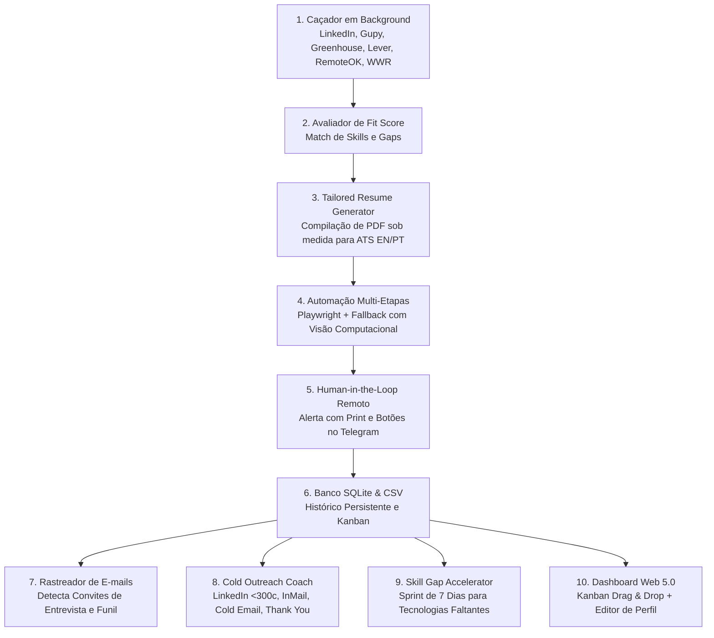

# 🤖 Agente Candidato Inteligente (Versão 5.0 Pro Suite)

Um sistema completo, autônomo e de nível empresarial em Python que **caça oportunidades no Brasil e no mundo, adapta seu currículo sob medida para ATS em inglês ou português, redige cartas de apresentação, preenche formulários multi-etapas, solicita aprovação remota via Telegram, rastreia convites de entrevista por e-mail, gera mensagens de cold outreach e oferece um Dashboard Web interativo com Kanban Drag & Drop**.

---

## 🌟 Arquitetura Completa de Recursos



---

## 🚀 Os Grandes Pilares da Versão 5.0

### 1. 📋 Dashboard Visual Web com Quadro Kanban Drag & Drop
- **Alternador de Visualização:** Alterne livremente entre **Grade de Cards** e **Quadro Kanban**.
- **Arrastar e Soltar Nativo:** Arraste vagas entre as colunas (*Pendente*, *Aplicada*, *Entrevista 🎉*, *Oferta 🚀*, *Rejeitada*) com persistência automática no SQLite em tempo real.
- **Ações Rápidas por Vaga:** Acesse com 1 clique o Currículo ATS em PDF, Carta de Apresentação, Roteiro de Entrevista, Mensagens de Networking ou dispare a **Candidatura Automática** diretamente do navegador.
- **Editor de Perfil Web:** Edite suas informações pessoais, links do GitHub/LinkedIn, habilidades e resumo profissional diretamente pela interface web (com salvamento instantâneo no `config/profile.yaml`).
- **Acesso:** `python main.py dashboard` (abre em `http://127.0.0.1:8000`).

### 2. 💬 Módulo de Cold Outreach & Mensagens de Networking
- No mercado atual, entrar em contato direto com o recrutador ou líder técnico multiplica a taxa de resposta. O agente gera automaticamente 5 formatos de abordagem por vaga:
  1. **Nota de Convite do LinkedIn:** Texto ultraconciso com limite garantido de **< 300 caracteres** para adicionar na solicitação de conexão.
  2. **LinkedIn InMail / Mensagem Direta:** Pitch técnico de ~120 palavras conectando suas competências com as dores da vaga.
  3. **Cold Email para o Tech Lead / Gerente de Engenharia:** Email estruturado com linha de assunto atraente, links do GitHub e chamada para bate-papo de 10 minutos.
  4. **Follow-up de 7 Dias:** Acompanhamento elegante e sem pressão para o caso de ausência de resposta.
  5. **Agradecimento Pós-Entrevista (Thank You Note):** Mensagem para envio nas primeiras 4 horas pós-entrevista, reiterando entusiasmo e pontos técnicos discutidos.
- **Comando dedicado:** `python main.py outreach <id_ou_url>`.

### 3. 🚀 Plano de Aceleração Técnica & Sprint de 7 Dias (Skill Gap Roadmap)
- Não deixe que uma tecnologia faltante (ex: Docker, Kubernetes, GraphQL) elimine você do processo.
- O agente diagnostica as lacunas técnicas da vaga e gera um **Roteiro Prático de Estudos de 7 Dias**:
  - *Dias 1-2:* Fundamentos e arquitetura crítica.
  - *Dias 3-4:* Mini-projeto prático conectando sua stack atual à ferramenta faltante.
  - *Dias 5-6:* Cenários de produção, observabilidade e armadilhas comuns.
  - *Dia 7:* Simulação de entrevista com as perguntas mais prováveis.
  - **Script de Defesa Estratégica:** Roteiro de fala honesto e convincente para responder à pergunta *"Você já trabalhou com X no dia a dia?"*.
- **Comando dedicado:** `python main.py roadmap <id_ou_url>`.

### 4. 🌍 Suporte Internacional & Adaptação Multi-Idioma para ATS
- Detecta automaticamente o idioma da vaga (Inglês ou Português).
- Em vagas internacionais (ex: RemoteOK, WeWorkRemotely, Greenhouse dos EUA):
  - O currículo PDF sob medida adapta seções automaticamente (*Professional Summary*, *Technical Skills*, *Core Skills*, *Professional Experience*, *Education & Languages*).
  - A carta de apresentação e mensagens de networking são formuladas em inglês técnico nativo e fluente.
- **Comando dedicado:** `python main.py remote-search <termo>`.

### 5. 📄 Compilador de Currículo ATS Sob Medida (< 0.1s com ReportLab)
- Elimina o gargalo de navegadores pesados: compila PDFs limpos, modernos e 100% legíveis por softwares de triagem ATS (Applicant Tracking Systems) em fração de segundo.
- Reorganiza suas habilidades para dar destaque imediato às competências mais exigidas pela empresa.
- **Comando dedicado:** `python main.py tailor-resume <id_ou_url>`.

### 6. 📱 Controle Remoto via Telegram & Human-in-the-Loop
- O robô preenche o formulário, tira um print da tela e envia diretamente para o seu Telegram com botões interativos:
  - `[ 🚀 Aprovar & Enviar ]`
  - `[ ❌ Cancelar / Pular ]`
- O envio só é submetido após a sua confirmação explícita no celular ou terminal!

### 7. 📬 Rastreador de Feedback por E-mail & Funil
- Conecta via IMAP à sua caixa postal para capturar retornos de recrutadores e identificar automaticamente convites para entrevistas.
- **Comandos:** `python main.py track-emails` e `python main.py funnel`.

---

## 📂 Estrutura do Projeto

```
agent_candidato/
├── config/
│   ├── profile.yaml            # Seu perfil, habilidades, links, FAQ e histórias STAR
│   └── profile.example.yaml    # Modelo de referência
├── core/
│   ├── config.py               # Leitura e persistência de perfil e .env
│   ├── database.py             # SQLite com migrações automáticas e exportação CSV
│   ├── llm.py                  # IA para Fit Score, gaps, cartas e respostas STAR
│   ├── models.py               # Modelos Pydantic (Job, CandidateProfile, etc.)
│   ├── resume_tailor.py        # Compilador ReportLab de currículo sob medida para ATS (EN/PT)
│   ├── interview_coach.py      # Preparador técnico e comportamental com método STAR
│   ├── networking.py           # Gerador de Cold Outreach (LinkedIn <300c, InMail, Email)
│   └── skill_roadmap.py        # Plano de aceleração de estudos de 7 dias
├── automation/
│   ├── browser_manager.py      # Gerenciamento de Chromium Playwright com anti-detecção
│   ├── form_mapper.py          # Mapeamento semântico de inputs, selects e LGPD
│   ├── visual_agent.py         # Set-of-Marks visual fallback por coordenadas
│   └── applicant.py            # Orquestrador multi-etapas com validação Telegram
├── notifications/
│   └── telegram_bot.py         # Bot Telegram com imagens, PDFs e botões inline
├── scheduler/
│   └── hunter.py               # Caçador autônomo periódico em background
├── email_tracker/
│   └── tracker.py              # Leitor IMAP de convites de entrevista
├── scrapers/
│   ├── base.py                 # Classe base abstrata
│   ├── gupy.py                 # Extrator nativo da Gupy (*.gupy.io)
│   ├── greenhouse.py           # Extrator Greenhouse
│   ├── lever.py                # Extrator Lever
│   ├── workable.py             # Extrator Workable
│   ├── linkedin_search.py      # Pesquisa pública de vagas no LinkedIn sem login
│   ├── remote_boards.py        # WeWorkRemotely RSS + RemoteOK API
│   └── universal.py            # Fallback universal para qualquer site de vagas
├── web/
│   ├── app.py                  # Servidor FastAPI com endpoints REST e background tasks
│   └── index.html              # Interface visual Tailwind CSS + Kanban Drag & Drop
├── data/                       # PDFs gerados, banco applications.db e formulários de teste
├── main.py                     # CLI interativa com 17 comandos
└── requirements.txt            # Dependências Python
```

---

## 🛠️ Tabela Completa de Comandos da CLI

| Comando | Descrição |
| :--- | :--- |
| `python main.py dashboard` | Inicia o **Painel Visual Web interativo com Kanban Drag & Drop** |
| `python main.py setup` | Valida perfil, arquivos, chaves de IA e status do Telegram |
| `python main.py apply <url>` | Analisa a vaga, gera currículo sob medida e preenche no navegador |
| `python main.py outreach <id>` | Gera 5 mensagens de **Cold Outreach e Networking** (LinkedIn <300c, InMail, Email) |
| `python main.py roadmap <id>` | Elabora o **Sprint de 7 Dias para Lacunas Técnicas** da vaga |
| `python main.py kanban` | Exibe o **Quadro Kanban de Candidaturas** direto no terminal |
| `python main.py interview-prep <id>` | Gera roteiro completo de preparação para entrevista técnica & comportamental |
| `python main.py tailor-resume <id_ou_url>` | Compila currículo PDF sob medida (ATS-friendly) em fração de segundo |
| `python main.py cover-letter <id_ou_url>` | Redige carta de apresentação personalizada para a vaga |
| `python main.py remote-search <termo>` | Busca vagas remotas globais nas plataformas RemoteOK e WeWorkRemotely |
| `python main.py search <termo>` | Pesquisa vagas abertas no LinkedIn pelo terminal |
| `python main.py auto-hunt` | Ativa o Caçador Autônomo em segundo plano para monitorar novas vagas |
| `python main.py track-emails` | Sincroniza retornos de RH e convites de entrevista via e-mail (IMAP) |
| `python main.py funnel` | Exibe o Funil de Conversão (Inscrições -> Entrevistas -> Ofertas) |
| `python main.py history` | Exibe histórico com Fit Score e status de todas as vagas |
| `python main.py export` | Exporta todo o histórico para uma planilha CSV |
| `python main.py test-local` | Executa teste local em formulário simulado sem riscos |

---

## ⚙️ Configuração das Integrações (.env)

Copie o arquivo `.env.example` para `.env` e configure suas chaves:

```env
# Inteligência Artificial (Opcional - há fallback determinístico inteligente sem chaves)
GEMINI_API_KEY=sua_chave_gemini_aqui
LLM_MODEL=gemini-2.0-flash

# Aprovação e Alertas pelo Celular (Telegram)
TELEGRAM_BOT_TOKEN=seu_bot_token_aqui
TELEGRAM_CHAT_ID=seu_chat_id_aqui

# Rastreador de Convites de Entrevista por E-mail (IMAP)
EMAIL_IMAP_HOST=imap.gmail.com
EMAIL_USER=seu_email@gmail.com
EMAIL_PASSWORD=sua_senha_de_app_gmail
```
